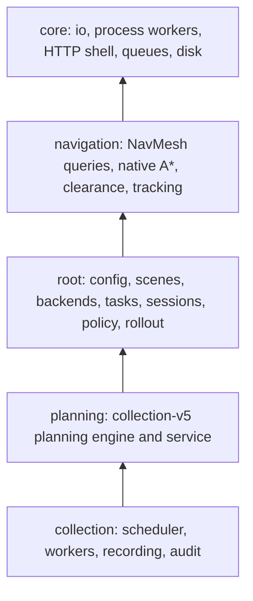
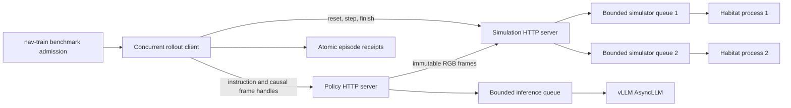

# Package layout

Each layer imports only itself and the layers below; `tests/test_layering.py` enforces
this. `cli.py` and `acceptance/` are composition roots and may import every layer.

- `core.process.ProcessWorker` is the one spawned-child abstraction: a keyed
  request/reply pipe, a ready handshake, deadlines, cooperative cancellation and
  terminate→kill escalation. Simulator sessions, collection actors and planners are
  hosts behind it; work is never replayed after a child dies.
- `core.http.service_app` is the shared FastAPI lifespan and `WorkerError` → HTTP
  status mapping used by all four services.
- `backends.runtime.RuntimeProfile` names a Habitat build (`habitat` 0.3.1 mesh,
  `habitat_gs` 0.3.3 CUDA Gaussian splatting) and the scene source it requires. One
  `HabitatEnvironment` serves both; the depth contract comes from
  `backends.depth.depth_contract`.
- `scenes` resolves a dataset's scene ID through `MeshSource` or `ScanPackageSource`;
  configuration load rejects a dataset whose scenes do not match the runtime.
- `tasks` holds task semantics (`NavigationTask`, `DevelopmentTask`): episode
  validation and metrics, independent of rendering.
- Planning is native-only (`sim_engine.navigation._astar`, built by `setup.py`). The
  Python reference planner used for parity lives in `tests/reference_planner.py`.
- `collection.service.CollectionService` schedules task phases; `collection.schedule`
  owns the frozen rolling scene window, `collection.workers` the actor processes and
  `collection.server` only the HTTP routes.

# Service boundaries

The simulator owns episode state and physical execution. Each session reserves a
single spawned worker process, which owns its Habitat and EGL context. A worker
executes requests through one serialized pipe. HTTP cancellation cannot leave an
unread pipe response for the next request. An unexpected partial execution or a
worker disconnect invalidates that session and fails the operation.

Each simulator worker has its own bounded FIFO. The policy has an independent
bounded inference queue whose consumers submit requests to AsyncLLM. A completed
request resolves its own future immediately. Episode actors submit that result
to the owning simulation queue, then submit the new observation for inference.
There is no cross-episode batch completion barrier. Slow episodes retain their
own causal order while other episodes advance. Queue capacity, active work,
completion/failure counts, queue wait and service time are exposed in health.

Simulation steps use an event-index compare-and-set and a request ID. Duplicate
execution returns the prior receipt; stale decisions and conflicting retries fail.
A caller must explicitly close its session. Capacity exhaustion returns 429. A dead
worker reduces capacity until the simulator is restarted; health exposes the live
worker count. There is no automatic replay of partially executed actions.

The policy server fetches only the supplied immutable frame handles. It prepares
images using the frozen training path: area-cap resize, Qwen smart resize, then
processor normalization with resizing disabled. It caches prepared images and
passes stable image UUIDs to vLLM. The engine schedules concurrent requests and
prefix caching; each episode's next action still waits for its actual observation.

Recorded requests may instead supply preallocated PNG images with `prepared=true`.
The service verifies hashes, patch-grid alignment and the pixel cap, then preserves
the decoded pixels without another resize. PNG decoding and prompt construction
run in worker threads outside the engine event loop. A configured LoRA adapter is
applied to all requests in that policy instance; distinct experiment arms use
distinct instances. The caller may require an exact visual-token count.

Goals, reference paths, geodesic rewards and global poses are privileged simulator
or evaluator data. They are never fields in the generation request. This separation
also permits a future learner to collect transitions without exposing reward
computation inputs to the acting policy.

The present service holds fixed checkpoint weights. A long-horizon RL integration
still needs a learner, weight synchronization with explicit versions, an on-policy
or bounded-staleness collection rule, validated rewards, and transition-level
termination/truncation handling. Token log-probabilities and executed action
prefixes are recorded as the interface for that work; they do not implement a
training algorithm.

Evaluation identities include checkpoint hashes, processor versions, prompt and
implementation hashes, assets, physical camera configuration, episode selection
and concurrency. Clients may mount the same NFS files at different absolute paths;
benchmark admission compares file content. Camera or engine changes require a new
output directory. Quality comparisons must use the same serving backend on both
sides.
