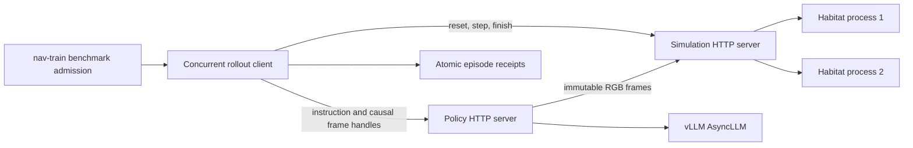

# Service boundaries

The simulator owns episode state and physical execution. Each session reserves a
single spawned worker process, which owns its Habitat and EGL context. A worker
executes requests through one serialized pipe. HTTP cancellation cannot leave an
unread pipe response for the next request. An unexpected partial execution or a
worker disconnect invalidates that session and fails the operation.

Simulation steps use an event-index compare-and-set and a request ID. Duplicate
execution returns the prior receipt; stale decisions and conflicting retries fail.
A caller must explicitly close its session. Capacity exhaustion returns 429. A dead
worker reduces capacity until the simulator is restarted; health exposes the live
worker count. There is no automatic replay of partially executed actions.

The policy server fetches only the supplied immutable frame handles. It prepares
images using the frozen training path: area-cap resize, Qwen smart resize, then
processor normalization with resizing disabled. It caches prepared images and
passes stable image UUIDs to vLLM. The engine schedules concurrent requests and
prefix caching; each episode's next action still waits for its actual observation.

Goals, reference paths, geodesic rewards and global poses are privileged simulator
or evaluator data. They are never fields in the generation request. This separation
also permits a future learner to collect transitions without exposing reward
computation inputs to the acting policy.

The present service holds fixed checkpoint weights. A long-horizon RL integration
still needs a learner, weight synchronization with explicit versions, an on-policy
or bounded-staleness collection rule, validated rewards, and transition-level
termination/truncation handling. Token log-probabilities and executed action
prefixes are recorded as the interface for that work; they do not implement a
training algorithm.

Evaluation identities include checkpoint hashes, processor versions, prompt and
implementation hashes, assets, physical camera configuration, episode selection
and concurrency. Clients may mount the same NFS files at different absolute paths;
benchmark admission compares file content. Camera or engine changes require a new
output directory. Quality comparisons must use the same serving backend on both
sides.
